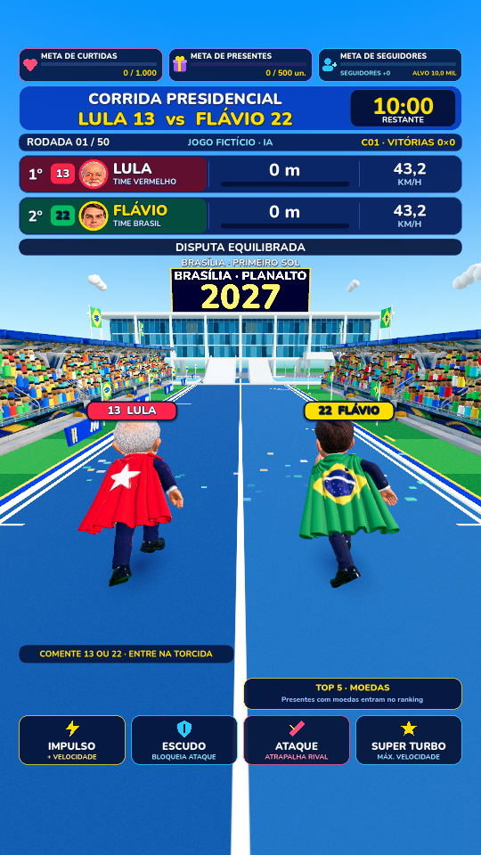

<p align="center">
  
</p>

<p align="center">
  <strong>Desenvolvimento web &nbsp;·&nbsp; Sistemas & APIs &nbsp;·&nbsp; Projetos interativos</strong>
</p>

<p align="center">
  Construo produtos digitais do fluxo de dados à experiência de quem usa.<br/>
  Meu foco é unir <strong>interfaces bem resolvidas</strong>, <strong>regras de negócio claras</strong> e <strong>software que possa evoluir</strong>.
</p>

<p align="center">
  <a href="#trabalhos-selecionados">Trabalhos selecionados</a> &nbsp;•&nbsp;
  <a href="#outros-projetos">Mais projetos</a> &nbsp;•&nbsp;
  <a href="#stack-e-ferramentas">Stack</a> &nbsp;•&nbsp;
  <a href="#como-eu-trabalho">Como trabalho</a> &nbsp;•&nbsp;
  <a href="#contato">Contato</a>
</p>

---

## Trabalhos selecionados

Uma seleção que mostra diferentes lados do meu trabalho: produtos web, fluxos completos, ferramentas de operação e experiências interativas. Os projetos têm níveis de maturidade distintos; apresento o estágio de cada um sem confundir código implementado com serviço disponível ao público.

### 01 / VOLKER — uma operação de e-commerce, da vitrine ao pedido

<p align="center">
  <a href="https://github.com/Kanexxxxx/Velkor_3"></a>
</p>

**O desafio:** ir além de uma página de produtos e estruturar uma experiência de compra com interface, API e administração.

**O que há no projeto:** catálogo e categorias, contas e sessões, carrinho, pedidos, cupons, área administrativa e integrações de pagamento e frete no código. Front-end e back-end são separados, com documentação de implantação e testes.

`Next.js` · `React` · `Node.js` · `Prisma` · `PostgreSQL`

**Estado:** aplicação implementada; integrações reais e disponibilidade pública não foram verificadas nesta apresentação.

[**Explorar repositório e arquitetura →**](https://github.com/Kanexxxxx/Velkor_3)

---

### 02 / Eurora Love — experiências digitais personalizadas

<p align="center">
  <a href="https://github.com/Kanexxxxx/Eurora"></a>
</p>

**O desafio:** conectar uma experiência visual a fluxos reais de criação, personalização e persistência.

**O que há no projeto:** páginas personalizadas, quiz, recursos para presentes e mensagens, rotas de API, persistência com Prisma e integrações de comunicação e checkout descritas no repositório.

`Next.js` · `TypeScript` · `Prisma` · `PostgreSQL`

**Estado:** código de aplicação disponível; hospedagem e fluxos externos exigem validação própria.

[**Conhecer o projeto →**](https://github.com/Kanexxxxx/Eurora)

---

### 03 / Vitraya Studio — da oferta ao material de divulgação

<p align="center">
  <a href="https://github.com/Kanexxxxx/Vitraya"></a>
</p>

**O desafio:** organizar em um único ambiente as tarefas repetitivas de quem prepara ofertas e conteúdo de afiliados.

**O que há no projeto:** catálogo local, importação de produtos, imagens, favoritos, cupons, legendas, direção de arte, exportação e backups. Conectores de envio existem, mas foram validados com provedores simulados — isso não equivale a publicação real.

`React` · `Vite` · `Node.js` · `SQLite`

**Estado:** aplicação local; integrações externas e trabalho entre versões ainda passam por revisão.

[**Ver fluxo e instruções de uso →**](https://github.com/Kanexxxxx/Vitraya)

---

### 04 / JOGI — um jogo 3D conectado a eventos de live

<p align="center">
  <a href="https://github.com/Kanexxxxx/JOGI"></a>
</p>

**O desafio:** transformar eventos de audiência em ações dentro de um jogo, isolando as regras, a interface e as integrações com as plataformas.

**O que há no projeto:** cena de jogo em Godot, ponte de eventos em Python, protocolos de comunicação, painéis administrativos e documentação de operação e segurança.

`Godot` · `GDScript` · `Python` · `WebSockets`

**Estado:** desenvolvimento e testes locais. A estreia pública depende de validações operacionais e de conformidade.

[**Explorar o JOGI e sua documentação →**](https://github.com/Kanexxxxx/JOGI)

---

## Outros projetos

Os destaques contam parte da história. O restante mostra amplitude: produtos de serviço, segurança, agendamento, experimentação e estudo.

| Projeto | O que estou construindo / explorando | Estado e acesso |
| :--- | :--- | :--- |
| **[Studio Karol Carvalho](https://github.com/Kanexxxxx/Karol)** | Agendamento para atendimento, painel administrativo e assistente de WhatsApp com confirmação humana para operações sensíveis. | Código público; sem promessa de demo ativa. |
| **[Confia?](https://github.com/Kanexxxxx/Confia-)** | Serviço de análise antigolpe com explicações compreensíveis para links, perfis e outras entradas. | Em construção. |
| **[Nexakeep](https://github.com/Kanexxxxx/projeto-pessoal/tree/implementacao)** | Sites e agenda para pequenos negócios, com autenticação e separação de dados por operação. | Implementação em branch própria; `main` preserva planejamento. |
| **[Senac](https://github.com/Kanexxxxx/Senac)** | Exercícios e atividades organizadas por unidade curricular, documentando a evolução dos estudos. | Material de aprendizado. |

<details>
  <summary><strong>Mais frentes em desenvolvimento</strong></summary>

  <br/>

  - **Prumo:** aplicativo pessoal de finanças, com foco em transações, cartões, gastos e comportamento offline. Repositório privado; sem acesso público ao código.
  - **DARK:** fundação de um RPG inspirado em jogos de ação no Roblox, com módulos de cliente, servidor e recursos compartilhados. Repositório privado; projeto em evolução.

  Esses trabalhos são mencionados apenas em nível geral. A existência do projeto não significa produto concluído ou publicação autorizada.

</details>

## Stack e ferramentas

Gosto de trabalhar na interseção entre produto, interface e funcionamento interno. Estas tecnologias aparecem em projetos do meu portfólio — a lista representa experiência de uso, não uma classificação artificial de domínio.

| Camada | Tecnologias |
| :--- | :--- |
| **Interfaces** | `TypeScript` · `JavaScript` · `React` · `Next.js` · `Vite` · `Tailwind CSS` |
| **Serviços e dados** | `Node.js` · `Python` · `PostgreSQL` · `SQLite` · `Prisma` · `Supabase` |
| **Jogos e interação** | `Godot` · `GDScript` · `Luau` · `WebSockets` |
| **Qualidade e fluxo** | `Git` · `GitHub Actions` · `Playwright` · testes e documentação técnica |

### O que conecta esses projetos?

```text
Ideia e descoberta
      ↓
Experiência e interface
      ↓
Regras, serviços e dados
      ↓
Testes, documentação e evolução
```

O objetivo não é apenas fazer a primeira versão funcionar: é entender a relação entre decisões de interface, persistência, segurança, manutenção e experiência real de uso.

---

## Como eu trabalho

| Princípio | Na prática |
| :--- | :--- |
| **Clareza antes de complexidade** | O projeto deve ter um objetivo compreensível e uma arquitetura que faça sentido. |
| **Interface com intenção** | Legibilidade, responsividade, estados de erro e consistência fazem parte da funcionalidade. |
| **Regras explícitas** | Autenticação, persistência, permissões e fluxos sensíveis precisam ser verificáveis. |
| **Mudanças rastreáveis** | Histórico Git, documentação, testes e caminhos de recuperação ajudam a evoluir sem perder trabalho. |

## Sobre

Sou **Kanex**, interessado em transformar ideias em aplicações que as pessoas consigam realmente utilizar. Minha trajetória reúne estudos em **Desenvolvimento de Sistemas** e projetos próprios que vão de plataformas web a automações e jogos interativos.

Gosto tanto do lado visual quanto das partes menos visíveis de um software: como os dados circulam, como uma regra é aplicada e o que acontece quando algo dá errado.

Este GitHub é o registro desse processo. Há projetos maiores, protótipos, experiências e estudos — cada um identificado pelo que efetivamente representa.

## Contato

Se quiser conversar sobre desenvolvimento, colaboração ou algum dos projetos:

**[Enviar um e-mail →](mailto:kainarodrigues684@gmail.com)**

**[Ver todos os repositórios públicos →](https://github.com/Kanexxxxx?tab=repositories)**

---

<p align="center">
  <sub>Kanex · Software feito para ser compreendido, utilizado e evoluído.</sub><br/>
  <sub>Identidade visual estática, sem widgets que dependam de serviços externos. Imagens são registros dos projetos, não prova de hospedagem ativa.</sub>
</p>

<details>
  <summary><strong>English / Short introduction</strong></summary>

  <br/>

  I build web applications, service integrations and interactive projects with an emphasis on product design, clear business logic and maintainable code. Explore the selected work above to see real repositories, implementation details and each project's current stage.

</details>
