

<picture>
  <source media="(max-width: 640px)" srcset="./assets/svg/hero-mobile.svg">
  
</picture>

  

<a href="#projetos"></a>

<a href="#atividade"></a>
<a href="#contato"></a>

 

Desenvolvo produtos web completos, da interface ao banco de dados e do deploy à automação, e jogos em Godot. Gosto de projetos em que design, dados e código precisam funcionar juntos.

 

<picture>
  <source media="(prefers-color-scheme: light)" srcset="./assets/svg/title-sobre-light.svg">
  
</picture>

<picture>
  
</picture>
<picture>
  
</picture>

 

<picture>
  <source media="(prefers-color-scheme: light)" srcset="./assets/svg/title-projetos-light.svg">
  
</picture>

<a href="https://github.com/Kanexxxxx/Karol"></a>
<a href="https://github.com/Kanexxxxx/Confia-"></a>
<a href="https://github.com/Kanexxxxx/Eurora"></a>
<a href="https://github.com/Kanexxxxx/Velkor_3"></a>
<a href="https://github.com/Kanexxxxx/JOGI"></a>
<a href="https://github.com/Kanexxxxx/Vitraya"></a>

<picture></picture>

 

<picture>
  
</picture>
<picture>
  
</picture>
<picture>
  
</picture>

<picture></picture>

 

| Projeto | O que é | Stack |
| :-- | :-- | :-- |
| [Nexakeep](https://github.com/Kanexxxxx/projeto-pessoal) | Sites e agendamento por loja para pequenos negócios. Em desenvolvimento na branch `implementacao`. | Next.js · TypeScript · PostgreSQL |
| [Senac](https://github.com/Kanexxxxx/Senac) | Atividades do curso de Desenvolvimento de Sistemas, organizadas por unidade curricular. | JavaScript · HTML · CSS |

 

<picture>
  <source media="(prefers-color-scheme: light)" srcset="./assets/svg/title-stack-light.svg">
  
</picture>

<picture>
  
</picture>
<picture>
  
</picture>
<picture>
  
</picture>
<picture>
  
</picture>

 

<picture>
  <source media="(prefers-color-scheme: light)" srcset="./assets/svg/title-atividade-light.svg">
  
</picture>

<picture>
  
</picture>
<picture>
  
</picture>

<picture>
  
</picture>

<picture></picture>

 

<picture>
  
</picture>

 

<picture>
  
</picture>

  

  

Cartões em SVG gerados por <a href="./scripts">scripts próprios</a> · números, linguagens e cobrinha atualizados todo dia por GitHub Actions

