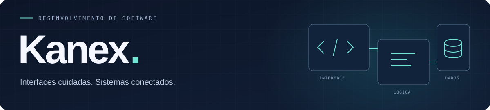
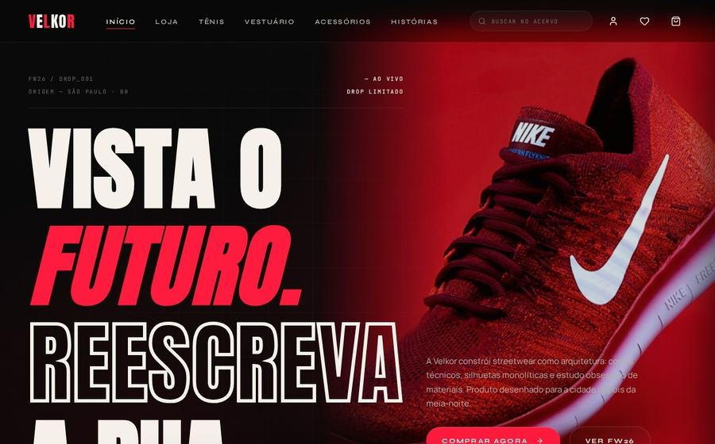
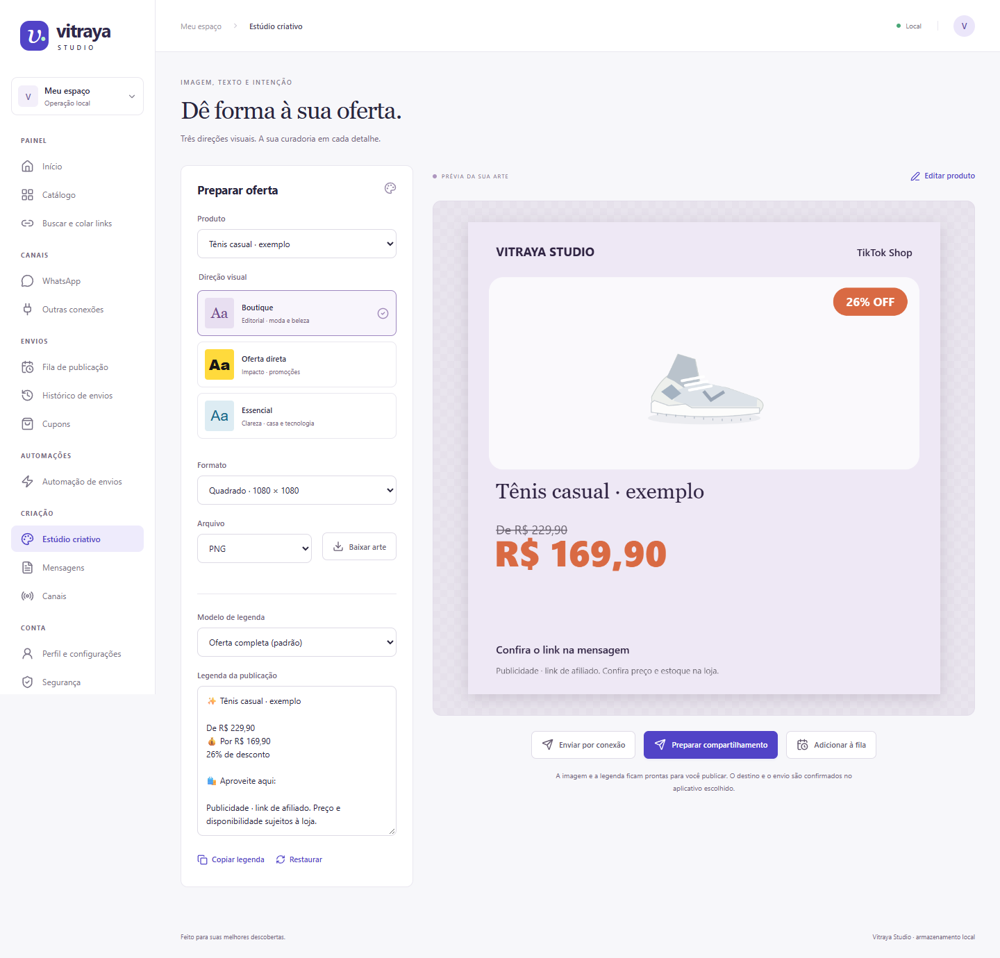

  

  <b>Aplicações web · Integrações · Projetos interativos</b> 
  Do modelo de dados à interface que as pessoas usam.

  <a href="#projetos"><b>Projetos</b></a> &nbsp; / &nbsp;
  <a href="#tecnologias"><b>Tecnologias</b></a> &nbsp; / &nbsp;
  <a href="#sobre"><b>Sobre</b></a> &nbsp; / &nbsp;
  <a href="mailto:kainarodrigues684@gmail.com"><b>Contato ↗</b></a>

---

## Projetos

Interfaces e sistemas que venho desenvolvendo. Cada projeto tem seu contexto, sua arquitetura e seu estágio; os repositórios detalham a implementação.

<table>
<tr>
<td width="50%" valign="top">

<h3>Eurora Love</h3>

Páginas personalizadas para casais, quiz, presentes e fluxos de mensagens. Uma experiência visual que conecta interface, conteúdo e integrações.

<code>Next.js</code> <code>TypeScript</code> <code>Prisma</code> <code>PostgreSQL</code>

Aplicação implementada · manutenção e deploy em revisão

<a href="https://github.com/Kanexxxxx/Eurora"><b>Explorar o projeto ↗</b></a>

</td>
<td width="50%" valign="top">

<h3>VOLKER / Velkor</h3>

E-commerce com catálogo, contas, carrinho, pedidos e administração. Frontend e API separados, com integrações de pagamento e frete.

<code>React</code> <code>Next.js</code> <code>Node.js</code> <code>PostgreSQL</code>

Aplicação implementada · identidade e versões em revisão

<a href="https://github.com/Kanexxxxx/Velkor_3"><b>Explorar o projeto ↗</b></a>

</td>
</tr>
</table>

Capturas das versões dos projetos preservadas no perfil. Não representam comprovação de operação atual nem de métricas exibidas pelas interfaces.

### Vitraya Studio

**Uma operação de ofertas, do catálogo à arte.** Aplicativo local para importar produtos com fotos, organizar cupons, preparar legendas e criar peças visuais. O exemplo acima mostra a direção Boutique do estúdio criativo.

`React` `Vite` `Node.js` `SQLite` &nbsp; · &nbsp; Desenvolvimento local, com integrações em revisão.

[**Conhecer o Vitraya ↗**](https://github.com/Kanexxxxx/Vitraya)

### Mais aplicações e projetos interativos

<table>
<tr>
<td width="50%" valign="top">
<h3>Karol</h3>

Site e agendamento para atendimento com hora marcada. Painel administrativo, agenda e mensagens, com confirmação humana nas operações do assistente.

<code>Next.js</code> <code>TypeScript</code> <code>Supabase</code>

Aplicação em evolução <a href="https://github.com/Kanexxxxx/Karol"><b>Ver código e documentação ↗</b></a>

</td>
<td width="50%" valign="top">
<h3>Nexakeep</h3>

Sites e agendamento por loja, com autenticação e separação de dados entre negócios. A branch de implementação contém a aplicação; a principal conserva o planejamento.

<code>Next.js</code> <code>PostgreSQL</code> <code>Better Auth</code>

Implementação local <a href="https://github.com/Kanexxxxx/projeto-pessoal/tree/implementacao"><b>Explorar a implementação ↗</b></a>

</td>
</tr>
<tr>
<td width="50%" valign="top">
<h3>Confia?</h3>

Projeto antigolpe em português, pensado para explicar os motivos de uma análise de links, perfis e outras entradas.

<code>Next.js</code> <code>TypeScript</code> <code>PostgreSQL</code>

Em construção <a href="https://github.com/Kanexxxxx/Confia-"><b>Conhecer o projeto ↗</b></a>

</td>
<td width="50%" valign="top">
<h3>JOGI</h3>

Corrida interativa em Godot. Uma ponte Python recebe eventos de transmissão e conecta a participação da audiência ao jogo.

<code>Godot</code> <code>GDScript</code> <code>Python</code> <code>WebSockets</code>

Desenvolvimento e validação local <a href="https://github.com/Kanexxxxx/JOGI"><b>Explorar o projeto ↗</b></a>

</td>
</tr>
</table>

<b>Como as versões do Confia se relacionam</b>

[confia-minimundo](https://github.com/Kanexxxxx/confia-minimundo) compartilha a base do Confia e acrescenta documentação. É uma versão relacionada, não outro produto independente.

---

## Tecnologias

Ferramentas utilizadas nos projetos públicos, organizadas pela função que exercem.

**Interfaces**

**Serviços e dados**

**Qualidade e interatividade**

Testes unitários e Playwright fazem parte do trabalho de qualidade. Supabase e Better Auth aparecem nos projetos de identidade e acesso.

---

## Sobre

Sou **Kanex**, estudante de Técnico em Desenvolvimento de Sistemas. Desenvolvo interfaces, APIs, integrações e ferramentas, com interesse em como as partes se conectam: dados, regras de negócio e experiência de uso.

Meu trabalho reúne aplicações web, automações e projetos interativos. Gosto de construir soluções que também possam ser compreendidas, testadas e mantidas depois da primeira entrega.

### Estudos e aprendizado

- [**Senac**](https://github.com/Kanexxxxx/Senac) — atividades por unidade curricular do curso de Desenvolvimento de Sistemas.

---

<b>Vamos conversar sobre desenvolvimento?</b> <a href="mailto:kainarodrigues684@gmail.com">kainarodrigues684@gmail.com</a>

