

<picture>
  <source media="(max-width: 640px)" srcset="./assets/svg/hero-mobile.svg">
  
</picture>

  

 

Desenvolvo produtos web completos, da interface ao banco de dados e do deploy à automação, e jogos em Godot. Gosto de projetos em que design, dados e código precisam funcionar juntos.

 

<picture>
  <source media="(prefers-color-scheme: light)" srcset="./assets/svg/title-sobre-light.svg">
  
</picture>

<picture>
  
</picture>
<picture>
  
</picture>

 

<picture>
  <source media="(prefers-color-scheme: light)" srcset="./assets/svg/title-projetos-light.svg">
  
</picture>

<picture></picture>

 

<picture>
  <source media="(max-width: 640px)" srcset="./assets/shots/karol-mobile.webp">
  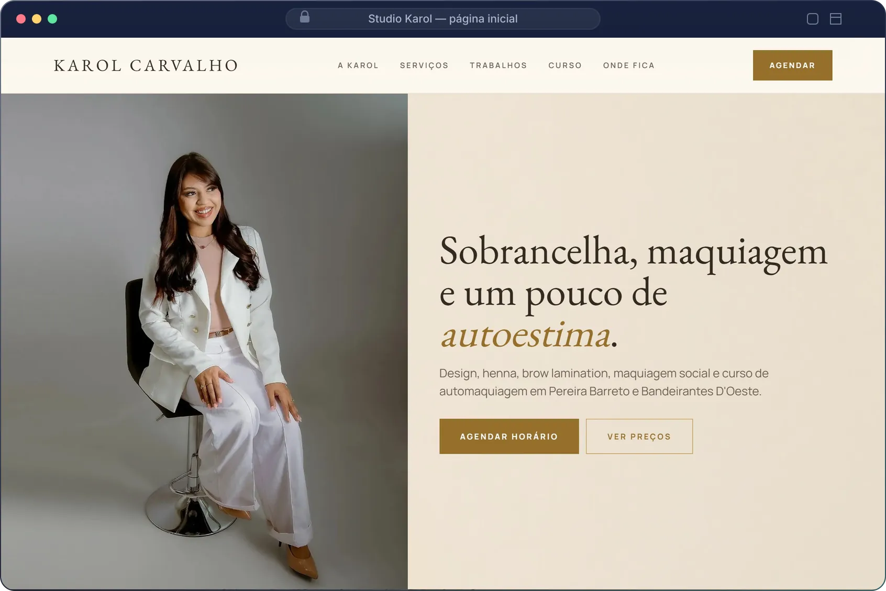
</picture>
<b>Studio Karol</b> · página inicial

  

<picture>
  <source media="(max-width: 640px)" srcset="./assets/shots/eurora-mobile.webp">
  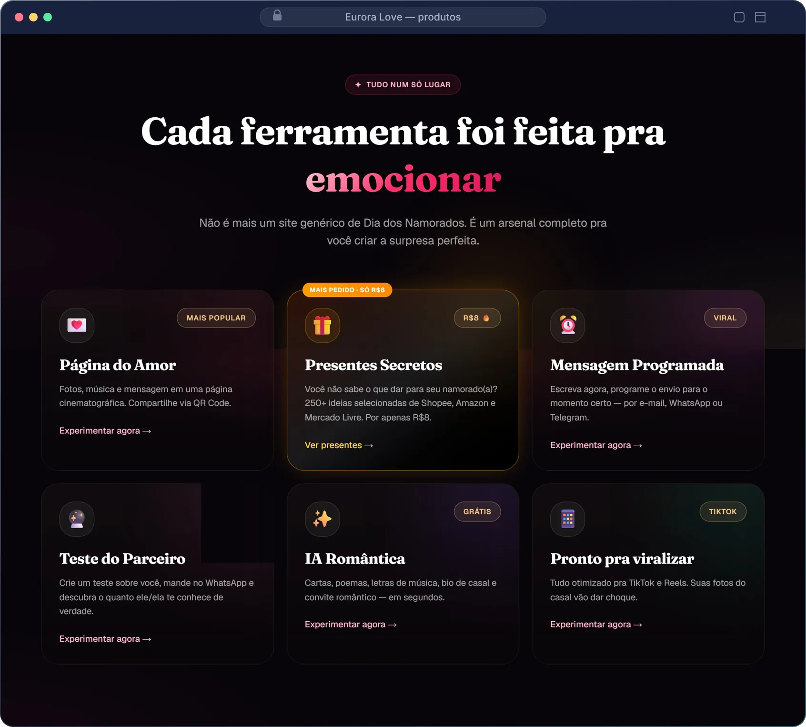
</picture>
<b>Eurora Love</b> · produtos da plataforma

  

<picture>
  <source media="(max-width: 640px)" srcset="./assets/shots/volker-mobile.webp">
  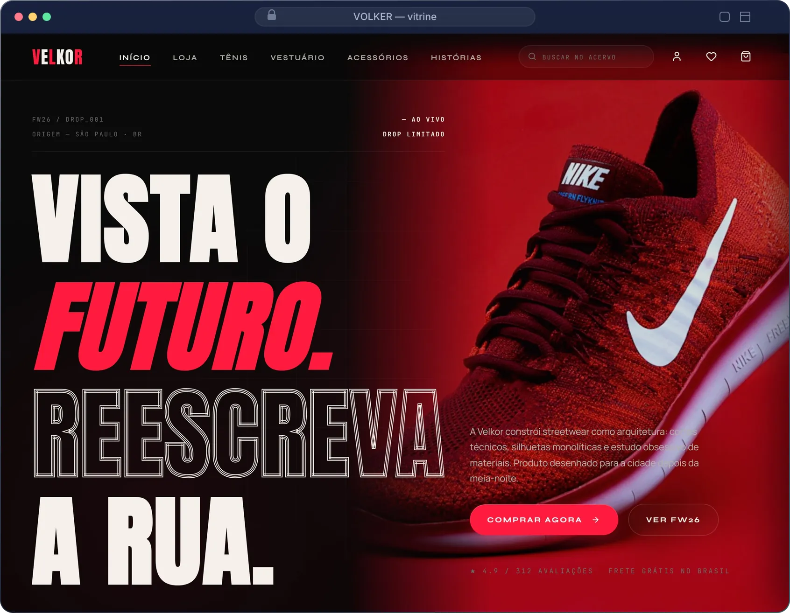
</picture>
<b>VOLKER</b> · vitrine da loja

  

<picture>
  <source media="(max-width: 640px)" srcset="./assets/shots/confia-mobile.webp">
  
</picture>
<b>Confia?</b> · verificação antigolpe

  

<picture>
  <source media="(max-width: 640px)" srcset="./assets/shots/vitraya-mobile.webp">
  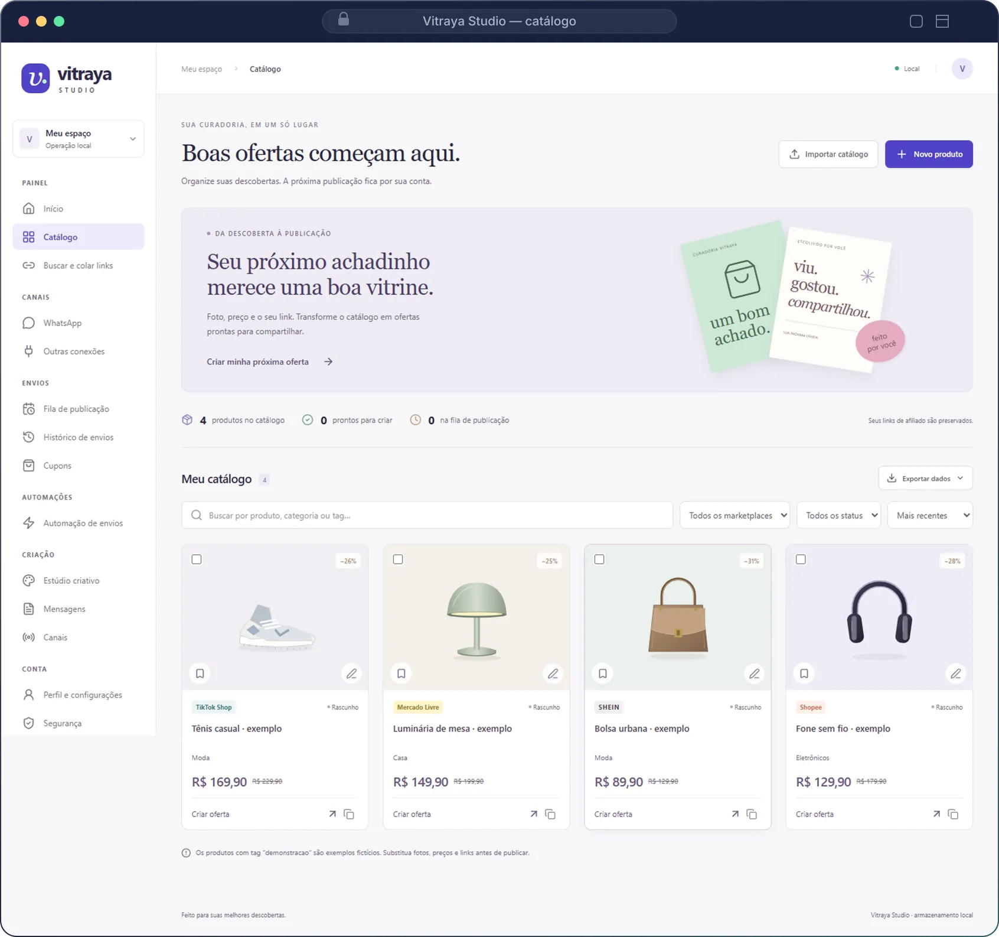
</picture>
<b>Vitraya Studio</b> · catálogo

<picture></picture>

 

| Projeto | O que é | Stack |
| :-- | :-- | :-- |
| [Nexakeep](https://github.com/Kanexxxxx/projeto-pessoal) | Sites e agendamento por loja para pequenos negócios. Em desenvolvimento na branch `implementacao`. | Next.js · TypeScript · PostgreSQL |
| [Senac](https://github.com/Kanexxxxx/Senac) | Atividades do curso de Desenvolvimento de Sistemas, organizadas por unidade curricular. | JavaScript · HTML · CSS |

 

<picture>
  <source media="(prefers-color-scheme: light)" srcset="./assets/svg/title-stack-light.svg">
  
</picture>

Cada cartão abre o site oficial da tecnologia. As linguagens se atualizam sozinhas a partir dos repositórios.

<picture>
  
</picture>

<!-- STACK:LANGUAGES:START -->
<a href="https://www.typescriptlang.org"></a>
<a href="https://developer.mozilla.org/pt-BR/docs/Web/JavaScript"></a>
<a href="https://www.python.org"></a>
<a href="https://docs.godotengine.org/en/stable/tutorials/scripting/gdscript/index.html"></a>
<a href="https://developer.mozilla.org/pt-BR/docs/Web/HTML"></a>
<a href="https://developer.mozilla.org/pt-BR/docs/Web/CSS"></a>
<a href="https://www.gnu.org/software/bash/"></a>

<a href="https://learn.microsoft.com/powershell/"></a>
<a href="https://luau.org"></a>
<!-- STACK:LANGUAGES:END -->

 

<picture>
  
</picture>

<!-- STACK:WEB:START -->
<a href="https://nextjs.org"></a>
<a href="https://react.dev"></a>
<a href="https://tailwindcss.com"></a>

<a href="https://nodejs.org"></a>
<a href="https://supabase.com"></a>
<a href="https://www.postgresql.org"></a>
<a href="https://www.prisma.io"></a>
<a href="https://orm.drizzle.team"></a>
<a href="https://sqlite.org"></a>
<a href="https://zod.dev"></a>
<!-- STACK:WEB:END -->

 

<picture>
  
</picture>

<!-- STACK:INFRA:START -->
<a href="https://www.docker.com"></a>
<a href="https://nginx.org"></a>
<a href="https://ubuntu.com"></a>
<a href="https://pm2.keymetrics.io"></a>
<a href="https://letsencrypt.org"></a>
<a href="https://vercel.com"></a>
<a href="https://github.com/features/actions"></a>
<a href="https://git-scm.com"></a>
<a href="https://github.com"></a>
<a href="https://code.visualstudio.com"></a>
<a href="https://playwright.dev"></a>

<a href="https://docs.pytest.org"></a>
<a href="https://godotengine.org"></a>

<!-- STACK:INFRA:END -->

 

<picture>
  
</picture>

<!-- STACK:INTEGRATIONS:START -->
<a href="https://developers.facebook.com/docs/whatsapp/cloud-api"></a>
<a href="https://doc.evolution-api.com"></a>
<a href="https://core.telegram.org/bots/api"></a>

<a href="https://docs.asaas.com"></a>
<a href="https://www.bcb.gov.br/estabilidadefinanceira/pix"></a>
<a href="https://docs.melhorenvio.com.br"></a>
<a href="https://api-docs.deepseek.com"></a>
<a href="https://affiliate.shopee.com.br"></a>
<a href="https://resend.com"></a>
<a href="https://nodemailer.com/usage/using-gmail/"></a>
<a href="https://developer.mozilla.org/pt-BR/docs/Web/API/WebSockets_API"></a>
<!-- STACK:INTEGRATIONS:END -->

 

<picture>
  <source media="(prefers-color-scheme: light)" srcset="./assets/svg/title-atividade-light.svg">
  
</picture>

<picture>
  
</picture>
<picture>
  
</picture>

<picture>
  
</picture>

<picture>
  
</picture>

 

<picture>
  
</picture>

  

  

Cartões em SVG gerados por <a href="./scripts">scripts próprios</a> · números, linguagens, progresso, cobrinha e calendário 3D sincronizados a cada 3 horas por GitHub Actions

